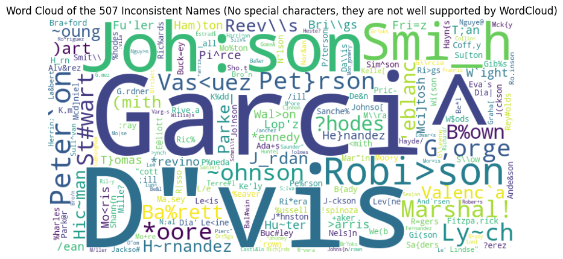
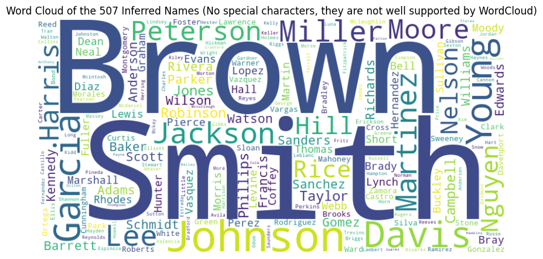

<div align="center">

# 🧹 ECC Data Cleansing


**A professional data cleaning and preprocessing pipeline developed at École Centrale Casablanca**

[](https://www.python.org/)
[](https://github.com/astral-sh/uv)
[](LICENSE)
[](https://jupyter.org/)

*Academic Exchange Program - May 2024*

</div>

---

## Overview

This project demonstrates a comprehensive approach to **data quality assurance** and **dataset preparation**. It performs systematic data exploration, validation, and transformation on raw datasets to ensure they're production-ready for downstream analysis and machine learning applications.

### Before & After

<div align="center">
  
  
</div>

## ✨ Key Features

- 📊 **Comprehensive Data Exploration**: Statistical summaries, distribution analysis, and data profiling
- 🔤 **Text Processing**: String matching using fuzzy logic and natural language processing (NLTK)
- 👥 **Gender Classification**: Automated gender identification from names using specialized libraries
- 📈 **Advanced Visualization**: Word clouds and geographical mapping with Basemap
- ✅ **Data Validation**: String similarity analysis and data consistency checks
- 🔄 **Reproducible Workflow**: Complete pipeline from raw data to cleaned output

## 📁 Project Structure

```
ecc-data-cleansing/
├── 📊 notebook/
│   └── final_project.ipynb      # Complete analysis pipeline (interactive)
├── 📂 data/
│   ├── raw/
│   │   └── project_3.csv        # Original dataset
│   └── cleaned/
│       └── output.csv           # Processed output
├── 🎨 asset/
│   ├── ecc_logo.png            # School logo
│   ├── dirty_data.png          # Before visualization
│   └── cleaned_data.png        # After visualization
├── 📋 pyproject.toml           # Dependencies & project metadata
└── 📖 README.md                # This file
```

## 🚀 Quick Start

### One-Command Setup

Get the entire project up and running with a single command:

```bash
# Clone the repository
git clone https://github.com/Romain-Jochum/ECC_Data_Cleansing.git
cd ECC_Data_Cleansing

# Install all dependencies and create virtual environment
uv sync --all-extras

# Activate the virtual environment
source .venv/bin/activate  # On Windows: .venv\Scripts\activate
```

## 📦 Dependencies

### Core Data Science Stack
| Package | Version | Purpose |
|---------|---------|---------|
| **pandas** | ≥2.0.0 | Data manipulation and analysis |
| **numpy** | ≥1.24.0 | Numerical computing |
| **matplotlib** | ≥3.7.0 | Data visualization |
| **seaborn** | ≥0.12.0 | Statistical visualizations |

### NLP & Text Processing
| Package | Version | Purpose |
|---------|---------|---------|
| **nltk** | ≥3.8.0 | Natural language processing |
| **fuzzywuzzy** | ≥0.18.0 | Fuzzy string matching |
| **python-Levenshtein** | ≥0.21.0 | String similarity algorithms |

### Specialized Tools
| Package | Version | Purpose |
|---------|---------|---------|
| **nomquamgender** | ≥1.0.0 | Gender classification from names |
| **wordcloud** | ≥1.9.0 | Word cloud visualization |
| **basemap** | ≥1.1.0 | Geographical mapping |

### Development
| Package | Purpose |
|---------|---------|
| **jupyter** | Interactive notebook environment |
| **ipykernel** | Jupyter kernel for Python execution |

## 🔬 Data Pipeline Overview

### Processing Steps

1. **Data Exploration** 📊
   - Load and inspect dataset structure
   - Generate statistical summaries
   - Identify missing values and anomalies

2. **Text Normalization** 🔤
   - Standardize string formats
   - Handle special characters and case sensitivity
   - Remove leading/trailing whitespace

3. **Duplicate Detection** 🔍
   - Fuzzy matching for near-duplicate records
   - String similarity scoring
   - Duplicate flagging and removal

4. **Gender Classification** 👥
   - Automated gender identification from names
   - Batch processing with confidence scores
   - Pattern matching and validation

5. **Advanced Analysis** 📈
   - Word frequency analysis
   - Word cloud generation
   - Geographical distribution mapping
   - Statistical correlations

6. **Quality Assurance** ✅
   - Data validation checks
   - Consistency verification
   - Output dataset generation

### Output
The cleaned dataset is exported to `data/cleaned/output.csv` with:
- ✓ No duplicate records
- ✓ Standardized formatting
- ✓ Gender classifications
- ✓ Complete data profiles

## 👤 Author

**Romain Jochum**

Developed at **École Centrale Casablanca**, Morocco during an academic exchange program (May 2024)

---

<div align="center">

### Show your support ⭐

If you found this project helpful, please consider giving it a star!

[⬆ back to top](#-ecc-data-cleansing)

</div>

*Published date: 28/05/2024*
